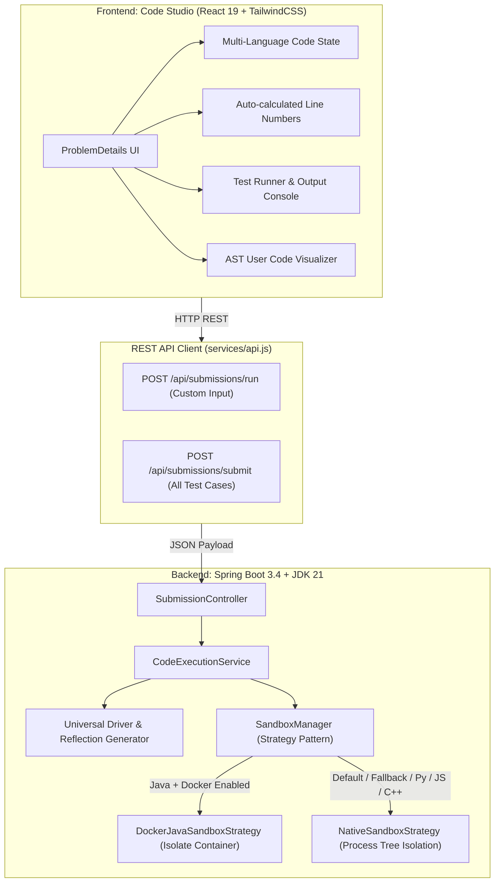
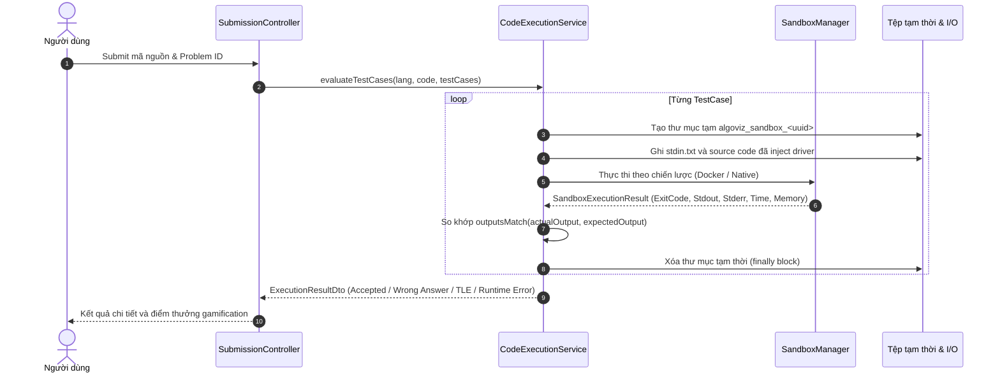

# Báo Cáo Kỹ Thuật: Kiến Trúc Sandbox & Code Editor (AlgoViz)

> **Tài liệu đặc tả toàn diện về hệ thống trình soạn thảo và môi trường thực thi mã an toàn (Sandbox Code Editor) trong AlgoViz.**

---

## 📑 Mục Lục
1. [Tổng Quan Kiến Trúc](#1-tổng-quan-kiến-trúc)
2. [Frontend: Trình Soạn Thảo & Visualizer Studio](#2-frontend-trình-soạn-thảo--visualizer-studio)
3. [Backend: Sandbox Execution Engine & Strategy Pattern](#3-backend-sandbox-execution-engine--strategy-pattern)
4. [Các Chiến Lược Thực Thi (Docker & Native)](#4-các-chiến-lược-thực-thi-docker--native)
5. [Bộ Sinh Mã Điều Khiển Thông Minh (Universal Driver Generator)](#5-bộ-sinh-mã-điều-khiển-thông-minh-universal-driver-generator)
6. [Quy Trình Chấm Điểm & So Khớp Kết Quả (Evaluation Engine)](#6-quy-trình-chấm-điểm--so-khớp-kết-quả-evaluation-engine)
7. [Bảo Mật, Phân Bổ Tài Nguyên & Rate Limiting](#7-bảo-mật-phân-bổ-tài-nguyên--rate-limiting)
8. [Bảng Tổng Hợp Tham Số Cấu Hình](#8-bảng-tổng-hợp-tham-số-cấu-hình)
9. [Đánh Giá Hiện Trạng & Đề Xuất Nâng Cấp](#9-đánh-giá-hiện-trạng--đề-xuất-nâng-cấp)

---

## 1. Tổng Quan Kiến Trúc

Hệ thống **Sandbox Code Editor** của AlgoViz được thiết kế theo mô hình khép kín 2 tầng: **Frontend Studio** tương tác thời gian thực và **Backend Execution Engine** bảo mật đa tầng.



---

## 2. Frontend: Trình Soạn Thảo & Visualizer Studio

### 2.1. Cấu trúc Tệp Nguồn
- **Trình soạn thảo & Studio điều khiển**: `frontend/src/features/problems/problemDetails.jsx`
- **Style giao diện & bố cục IDE**: `frontend/src/features/problems/problemDetails.css`
- **Bộ trực quan hóa mã người dùng (AST Frame Generator)**: `frontend/src/features/problems/UserCodeVisualizer.jsx`
- **Tầng giao tiếp API & Offline Fallback**: `frontend/src/services/api.js`

### 2.2. Các Đặc Tính Nổi Bật của Code Editor
1. **Quản lý trạng thái đa ngôn ngữ độc lập (`codeByLanguage`)**:
   - Hỗ trợ 4 ngôn ngữ lập trình phổ biến: `Python 3`, `JavaScript`, `C++`, và `Java`.
   - Mỗi ngôn ngữ duy trì một vùng nhớ code riêng trong React State. Khi người dùng chuyển qua lại giữa các ngôn ngữ qua thanh `CustomSelect`, mã đang viết không bị ghi đè hay mất dữ liệu.
2. **Thanh số dòng tự động (Auto-Numbered Gutter)**:
   - Dòng số được tính toán động dựa trên tổng số dòng ngắt `\n` của mã nguồn (`lineCount`).
   - Gutter đồng bộ chiều cao tuyệt đối với phần tử `<textarea className="editor-textarea">`, sử dụng phông chữ monospace tiêu chuẩn lập trình viên (`Fira Code`, `JetBrains Mono`).
3. **Thanh chia khung kéo thả linh hoạt (Draggable Resizer Divider)**:
   - Sử dụng thanh trượt `runner-resizer-divider` tích hợp Pointer Events (`onPointerDown`, `onPointerMove`, `onPointerUp`).
   - Cho phép điều chỉnh linh hoạt tỷ lệ chiều cao giữa Editor phía trên và Console / Testcases phía dưới trong khoảng an toàn từ **8% đến 88%**.
   - Hỗ trợ thao tác nhấp đúp (Double-click) hoặc nhấn phím điều hướng để khôi phục nhanh về tỷ lệ mặc định 50:50.
4. **Hai chế độ thực thi linh hoạt**:
   - **Run Code**: Thực thi nhanh với test case hiện tại hoặc dữ liệu nhập tùy biến (Custom Input) qua route `/api/submissions/run`.
   - **Submit Code**: Chấm điểm toàn diện toàn bộ test case của bài toán qua route `/api/submissions/submit`. Khi toàn bộ test case vượt qua, kích hoạt hiệu ứng vinh danh (`SubmissionCelebrationModal`) và hiển thị runtime/memory do server trả về. Không hiển thị phân vị khi backend chưa cung cấp dữ liệu này.
5. **Xử lý khi backend không khả dụng**:
   - Frontend hiển thị lỗi kết nối và cho phép thử lại. Không tạo phiên xác thực, submission hay kết quả Passed/Accepted giả. `npm run start:offline` chạy backend thật bằng H2 tạm thời. Animation minh họa thuật toán hoạt động độc lập và được ghi rõ là mô phỏng.

### 2.3. User Code AST Visualizer
- Tệp `UserCodeVisualizer.jsx` cung cấp cấu trúc **Pluggable Engine Adapter Hook**.
- Hệ thống có khả năng phân tích cú pháp mã do người dùng viết, trích xuất các biến trung gian (`nums`, `target`, `seen`, `diff`) và tự động dựng animation từng bước (Step-by-step Frame Engine):
  - Frame khởi tạo bảng băm / con trỏ.
  - Frame duyệt từng phần tử và kiểm tra giá trị bù (complement).
  - Frame tìm thấy kết quả và highlight ô nhớ thỏa mãn.

---

## 3. Backend: Sandbox Execution Engine & Strategy Pattern

Backend sử dụng mẫu thiết kế **Strategy Pattern** do `SandboxManager` điều phối, đảm bảo tính mở rộng cao và dễ dàng bổ sung các công nghệ cô lập khác (như Firecracker microVM, nsjail, WebAssembly) trong tương lai.

### 3.1. Phân Tầng Trách Nhiệm
- **`SandboxStrategy` (Interface)**:
  - `getStrategyName()`: Trả về định danh chiến lược (`DOCKER`, `NATIVE`).
  - `supportsLanguage(String language)`: Kiểm tra ngôn ngữ được hỗ trợ.
  - `isAvailable()`: Kiểm tra tính sẵn sàng của môi trường (Daemon Docker có đang chạy hay không).
  - `execute(SandboxExecutionRequest request)`: Thực thi lệnh và thu thập kết quả.
- **`SandboxManager` (Dispatcher)**:
  - Tự động sắp xếp các chiến lược theo thứ tự ưu tiên (`@Order`).
  - Lựa chọn chiến lược khả dụng cao nhất cho ngôn ngữ tương ứng.

```java
// backend/src/main/java/com/aisc/algoviz/submission/sandbox/SandboxManager.java
public Optional<SandboxStrategy> getAvailableStrategy(String language) {
    return strategies.stream()
            .filter(s -> s.supportsLanguage(language) && s.isAvailable())
            .findFirst();
}
```

---

## 4. Các Chiến Lược Thực Thi (Docker & Native)

### 4.1. Chiến Lược Docker Container (`DockerJavaSandboxStrategy`)
- **Thứ tự ưu tiên**: `@Order(1)` (Được ưu tiên chọn hàng đầu cho mã Java).
- **Điều kiện kích hoạt**: `algoviz.sandbox.docker.enabled=true` và Docker Daemon phản hồi lệnh `docker --version`.
- **Lệnh thực thi sinh ra động**:
  ```bash
  docker run --rm -i \
    --name algoviz-<uuid_12_chars> \
    --network none \
    --memory 256m \
    --cpus 1.0 \
    --pids-limit 64 \
    -v /tmp/algoviz_sandbox_xxx:/sandbox \
    -w /sandbox \
    eclipse-temurin:21-alpine \
    java <ClassName>.java
  ```

#### Rào Chắn An Toàn Của Docker Sandbox:
| Cơ chế | Cờ Docker | Mục đích bảo vệ |
| :--- | :--- | :--- |
| **Cách ly mạng tuyệt đối** | `--network none` | Chặn hoàn toàn socket ra ngoài internet, chống reverse shell, chống đào tiền ảo và SSRF. |
| **Giới hạn RAM** | `--memory 256m` | Tránh việc mã người dùng cố tình cấp phát mảng khổng lồ gây Out-Of-Memory (OOM) cho host. |
| **Giới hạn CPU** | `--cpus 1.0` | Không cho phép mã người dùng chiếm dụng tài nguyên tính toán của các luồng khác. |
| **Chống Fork Bomb** | `--pids-limit 64` | Giới hạn số lượng tiến trình tối đa, vô hiệu hóa hoàn toàn mã khai thác `while(true) fork()`. |
| **Tự hủy và dọn dẹp** | `--rm` & `docker kill` | Đảm bảo container không bị tích tụ rác; nếu vượt quá 5s sẽ cưỡng chế tắt trong 3s. |

---

### 4.2. Chiến Lược Native Process (`NativeSandboxStrategy`)
- **Thứ tự ưu tiên**: `@Order(100)` (Dùng cho Python, JavaScript, C++, và làm Fallback nếu Docker chưa sẵn sàng).
- **Đặc điểm**:
  1. **Phân giải Binary Thông minh**:
     - **Java**: Tự động giải quyết đường dẫn thực thi qua `System.getProperty("java.home")/bin/java`.
     - **Python**: Tự động nhận diện lệnh `python3` thay vì gọi `python` (ngăn chặn lỗi môi trường Linux).
     - **C++**: Kiểm tra sự tồn tại của `g++` với cờ `-std=c++17`, báo lỗi cấu hình nếu máy chủ chưa cài đặt.
     - **JavaScript**: Chạy trực tiếp qua `node script.js`.
  2. **Hủy tiến trình theo cây (Process Tree Destruction)**:
     - Khi một tiến trình bị Time Limit Exceeded (TLE), hệ thống quét toàn bộ tiến trình con cháu qua `process.descendants().forEach(ProcessHandle::destroyForcibly)` trước khi tắt tiến trình cha, tránh tạo Zombie Process trên hệ điều hành.

---

## 5. Bộ Sinh Mã Điều Khiển Thông Minh (Universal Driver Generator)

Người dùng khi giải bài trên AlgoViz chỉ cần viết các hàm thuần giải thuật theo chuẩn LeetCode mà không cần xử lý `stdin` hoặc in `stdout`. Backend tự động bổ sung **Code Wrapper Driver**:

### 5.1. Universal Python Driver (`PYTHON_UNIVERSAL_RUNNER`)
Nếu mã người dùng chứa `class Solution` hoặc khai báo hàm `def `:
1. Sử dụng module `sys.stdin.read()` để đọc dữ liệu thô.
2. Hỗ trợ tự động phân tích dữ liệu tham số dạng mảng `[2, 7, 11]`, số nguyên, chuỗi, hoặc dạng gán biến `nums = [...], target = 9`.
3. Sử dụng `ast.literal_eval` để chuyển đổi kiểu dữ liệu an toàn.
4. Tự động kiểm tra và gọi hàm giải thuật thông qua `globals()['Solution']()` hoặc tìm hàm khả thi đầu tiên.
5. Serialize kết quả trả về thành định dạng JSON chuẩn mực để so khớp với Testcase.

### 5.2. Java Driver Helper (`JavaDriverHelper`)
Nếu mã Java không chứa hàm `main`:
1. Quét tên lớp bằng Regex (`extractClassName`).
2. Tự động khởi tạo cấu trúc lớp điều khiển `Main` chứa `public static void main(String[] args)`.
3. Phân tích `stdin` thông qua `java.util.Scanner` và `Regular Expressions`.
4. Sử dụng **Java Reflection API** (`Class.forName("Solution").getDeclaredConstructor().newInstance()`) để invoke method của người dùng.
5. Định dạng kết quả in ra màn hình bằng `Arrays.toString()` hoặc `String.valueOf()`.

---

## 6. Quy Trình Chấm Điểm & So Khớp Kết Quả (Evaluation Engine)



### Thuật Toán So Khớp Linh Hoạt (`outputsMatch`)
Nhằm chống lỗi chấm sai do sai khác ngắt dòng giữa các hệ điều hành:
1. Chuẩn hóa tất cả ngắt dòng `\r\n` thành `\n`.
2. Kiểm tra khớp chính xác sau khi `trim()`.
3. Nếu chưa khớp, thực hiện chuẩn hóa mảng mềm: Bỏ các ký tự `[`, `]`, dấu phẩy `,` và so sánh chuỗi token chuẩn hóa.

---

## 7. Bảo Mật, Phân Bổ Tài Nguyên & Rate Limiting

1. **Vòng đời tệp tạm độc lập (Isolation per execution)**:
   - Mỗi lượt thực thi được gán một UUID riêng và thư mục tạm thời độc lập.
   - Thư mục được xóa sạch trong khối `finally { cleanupDirectory(tempDir); }`, không để lộ mã nguồn hay rò rỉ dữ liệu giữa các người dùng.
2. **Khống chế Thời gian Thực thi (TLE Prevention)**:
   - Giới hạn cứng `algoviz.execution.timeout-seconds = 5s`.
   - Nếu tiến trình không phản hồi trong 5 giây, hệ thống sẽ kích hoạt ngắt tiến trình và trả về trạng thái `Time Limit Exceeded`.
3. **Bộ lọc Hạn chế Tần suất (Rate Limiting Filter)**:
   - Cấu hình qua `RateLimitingFilter`: Giới hạn tối đa **20 requests/phút** đối với các thao tác nộp bài (`/api/submissions/**`), chống hành vi spam DDOS vào máy chủ thực thi mã.

---

## 8. Bảng Tổng Hợp Tham Số Cấu Hình

| Tham số cấu hình | Biến môi trường (.env) | Giá trị mặc định | Giải thích chức năng |
| :--- | :--- | :--- | :--- |
| `algoviz.execution.timeout-seconds` | `ALGOVIZ_EXECUTION_TIMEOUT_SECONDS` | `5` | Thời gian chạy tối đa trước khi ngắt TLE |
| `algoviz.execution.python-command` | `ALGOVIZ_PYTHON_COMMAND` | `python3` | Lệnh binary thực thi Python |
| `algoviz.execution.cpp-command` | `ALGOVIZ_CPP_COMMAND` | `g++` | Lệnh trình biên dịch C++ |
| `algoviz.sandbox.docker.enabled` | `ALGOVIZ_DOCKER_SANDBOX_ENABLED` | `false` | Bật/tắt chế độ cô lập Docker |
| `algoviz.sandbox.docker.image` | `ALGOVIZ_DOCKER_JAVA_IMAGE` | `eclipse-temurin:21-alpine` | Container image chạy Java Sandbox |
| `algoviz.sandbox.docker.memory` | `ALGOVIZ_DOCKER_MEMORY` | `256m` | Giới hạn dung lượng RAM Docker |
| `algoviz.sandbox.docker.cpus` | `ALGOVIZ_DOCKER_CPUS` | `1.0` | Giới hạn số nhân CPU Docker |
| `algoviz.sandbox.docker.pids-limit`| `ALGOVIZ_DOCKER_PIDS_LIMIT` | `64` | Giới hạn số tiến trình (chống fork bomb) |
| `algoviz.security.rate-limit.submissions.requests-per-minute` | `ALGOVIZ_RATE_LIMIT_SUBMISSIONS_RPM` | `20` | Giới hạn lượt submit mã mỗi phút |

---

## 9. Đánh Giá Hiện Trạng & Đề Xuất Nâng Cấp

### Điểm Mạnh Hiện Tại
- Hệ thống hỗ trợ đa ngôn ngữ đầy đủ (Python, JS, Java, C++).
- Có kiến trúc Strategy Pattern linh hoạt, tự động chuyển đổi giữa Docker và Native mà không cần sửa code.
- Giao diện có số dòng, chuyển tab ngôn ngữ không mất mã, có draggable resizer tiện lợi.
- Đã có cơ chế Universal Driver cho phép người dùng viết code tự do theo dạng hàm mà không cần viết hàm `main`.

### Đề Xuất Lộ Trình Nâng Cấp Tiếp Theo
1. **Tích hợp Monaco Editor**:
   - Hiện tại frontend đang sử dụng `<textarea>` kèm bộ tính số dòng thủ công. Có thể nâng cấp lên `@monaco-editor/react` (trình soạn thảo của VS Code) để hỗ trợ Syntax Highlighting, Auto-complete (IntelliSense) và Error Squiggles.
2. **Mở rộng Docker Sandbox cho toàn bộ ngôn ngữ**:
   - Hiện tại Docker Sandbox đang áp dụng cho Java. Có thể bổ sung Docker Image đa năng chứa sẵn Python 3.12, Node.js 20, GCC 13 để chạy toàn bộ các ngôn ngữ trong container cách ly mạng.
3. **Linux Kernel Sandboxing (nsjail / seccomp)**:
   - Với môi trường Native trên Linux, có thể áp dụng `nsjail` hoặc `isolate` để giới hạn syscalls và dung lượng bộ nhớ mà không cần phụ thuộc vào Docker Daemon.
