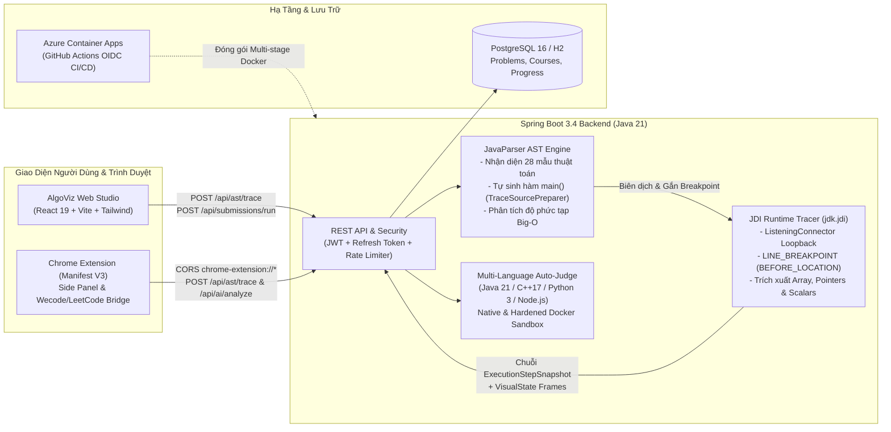

# Bộ Hồ Sơ Đăng Ký & Triển Lãm Cuộc Thi SEAPP (Khoa Công Nghệ Phần Mềm – UIT)
## Dự án: **AlgoViz — Nền tảng Học Thuật Toán Trực Quan (White-Box Runtime Trace) & Trợ Lý Debug Wecode/LeetCode**

> **Tài liệu này** được thiết kế chuẩn theo thể lệ cuộc thi **SEAPP (Software Engineering Application Playground)** do **Khoa Công nghệ Phần mềm – Trường Đại học Công nghệ Thông tin, ĐHQG-HCM (UIT)** tổ chức (`se.uit.edu.vn` / Fanpage **SeExpress**). Các nội dung dưới đây có thể sao chép trực tiếp để điền Google Form đăng ký, quay Video Demo, in Poster triển lãm tại **Sảnh Tầng 7 (E7.2) – Tòa nhà E, UIT** và chuẩn bị phản biện trước Hội đồng Ban Giám khảo.

---

## Phần 1: Nội Dung Điền Google Form Đăng Ký SEAPP

> **Lưu ý khi nộp Form:** Bắt buộc đăng nhập bằng email sinh viên UIT (`MSSV@gm.uit.edu.vn`) của Đội trưởng. Đội thi từ **1 – 6 thành viên**.

### 1.1. Thông tin định danh dự án
- **Tên sản phẩm / Dự án:** **AlgoViz — White-Box Algorithm Learning Platform & Live AST/JDI Runtime Visualizer**
- **Tên tiếng Việt gợi ý (kèm phụ đề):** **AlgoViz — Nền tảng Học Thuật Toán Trực Quan Từng Dòng Lệnh & Tiện Ích Mở Rộng Trợ Lý Wecode/LeetCode**
- **Bảng đăng ký dự thi:** **Bảng App** *(Web-based Application + Chrome Extension Manifest V3)*
- **Nguồn gốc sản phẩm:** Sản phẩm tự phát triển / Đồ án môn học Khoa Công nghệ Phần mềm (có thể liên kết cộng điểm các môn Đồ án CNPM, Phát triển Ứng dụng Web, Lập trình Hệ thống)

### 1.2. Tóm tắt bài toán & Lý do hình thành ý tưởng (Copy-paste vào ô Mô tả ngắn)
Trong quá trình học các môn nền tảng tại UIT như **IT003 (Cấu trúc dữ liệu và Giải thuật)**, **IT002 (Lập trình hướng đối tượng)** và **Thiết kế & Phân tích Thuật toán (DAA)**, sinh viên thường xuyên luyện tập trên hệ thống **Wecode UIT** và **LeetCode**. Tuy nhiên, các hệ thống chấm bài tự động (Online Judge) hiện nay hoạt động theo cơ chế **"Hộp đen" (Black-Box Judging)**: khi thuật toán chạy sai, sinh viên chỉ nhận được thông báo `Wrong Answer`, `Time Limit Exceeded` hoặc `Runtime Error` mà không thấy được trạng thái biến, con trỏ mảng (`i`, `j`, `left`, `right`) hay luồng thực thi thực tế bên trong bộ nhớ tại từng bước. Ngược lại, các trang web mô phỏng thuật toán truyền thống chỉ chiếu hoạt ảnh (animation) cố định cho code mẫu có sẵn chứ không chạy trên chính đoạn code do sinh viên tự viết.

**AlgoViz** ra đời để giải quyết triệt để khoảng trống đó bằng cơ chế **"Hộp trắng" (White-Box Runtime Visualization)**:
1. Cho phép sinh viên viết hoặc trích xuất trực tiếp đoạn code đang làm trên **Wecode UIT / LeetCode** ngay trong **Chrome Extension Side Panel** mà không cần chuyển tab.
2. Phân tích cú pháp bằng **JavaParser AST** và kết nối trực tiếp vào máy ảo JVM thực thông qua **Java Debug Interface (`jdk.jdi`)** để ghi lại snapshot bộ nhớ (`BEFORE_LOCATION`) ở từng dòng lệnh, từ đó dựng lại toàn bộ quá trình biến đổi mảng, con trỏ và biến cục bộ theo thời gian thực.

### 1.3. Các tính năng cốt lõi của hệ thống (Copy-paste vào ô Tính năng chính)
1. **Live Java AST + JDI Step-by-Step Runtime Tracer (Trực quan hóa luồng chạy thực tế từng dòng lệnh):**
   - Không dùng hoạt ảnh dựng sẵn: phân tích mã nguồn bằng **JavaParser AST**, tự động sinh hàm `main()` driver (`TraceSourcePreparer`) khi sinh viên chỉ nộp class `Solution` (hỗ trợ tham số `int[]`, `int`, `String`), và ánh xạ chính xác số dòng bytecode về dòng code trên trình soạn thảo.
   - Sử dụng **Java Debug Interface (`jdk.jdi` `ListeningConnector`)** để đặt breakpoint từng dòng (`LINE_BREAKPOINT`), thu thập trạng thái biến cục bộ, mảng 1 chiều, các con trỏ chỉ số (`pointers`) và giá trị vô hướng (`scalars`) ở từng bước thực thi (tối đa 2.000 bước, giới hạn an toàn 8 giây và 64 MiB heap cho tiến trình con).
2. **Nhận diện mẫu thuật toán tĩnh & Phân tích độ phức tạp Big-O bằng AST (`AlgorithmCatalog` 28 mẫu):**
   - Tự động quét cây cú pháp AST để nhận diện **28 mẫu thuật toán** thuộc 7 họ thuật toán cốt lõi (Sorting, Searching, Two Pointers/Sliding Window, Dynamic Programming, Greedy, Backtracking, Graph) kèm điểm tin cậy (`confidence`), bằng chứng dòng lệnh và cảnh báo lỗi tiềm ẩn tại `/api/algorithms/recognize` và `/api/ai/analyze`.
3. **Trình chạy & Chấm bài đa ngôn ngữ tự động (Multi-Language Auto-Judge Runner):**
   - Hỗ trợ biên dịch, chạy kiểm thử với Custom Input và chấm điểm tự động trên bộ test cases cho **4 ngôn ngữ phổ biến nhất tại UIT: Java 21, C++17 (`g++`), Python 3 và JavaScript (Node.js)**.
   - Hỗ trợ chế độ cách ly an toàn với Docker Sandbox (`--network none --memory 256m --cpus 1.0 --pids-limit 64`) và tự động dọn dẹp cây tiến trình khi quá thời gian (TLE 5s).
4. **Tiện ích mở rộng trình duyệt AlgoViz Side Panel & Code Bridge (Chrome Extension Manifest V3):**
   - Tích hợp trực tiếp vào **Wecode UIT (`*.uit.edu.vn`)**, **LeetCode (`leetcode.com`)** và các trang tài liệu học thuật.
   - Hỗ trợ 1-Click **"Grab from Active Editor"** (trích xuất thẳng code từ trình soạn thảo Monaco/Ace/CodeMirror trên trang bài tập) hoặc chuột phải chọn **"Trace in AlgoViz Side Panel"** để chạy trace từng bước, xem thanh trạng thái mảng, con trỏ và độ phức tạp Big-O ngay ở thanh bên trình duyệt.
5. **Hệ thống Khóa học cấu trúc, Thư viện bài tập & Theo dõi tiến độ cá nhân:**
   - Cung cấp 6 khóa học thuật toán có lộ trình, thư viện bài tập chuẩn hóa tương thích ID LeetCode (kèm lời giải tham khảo có sẵn runtime trace), hệ thống tài khoản bảo mật JWT + Refresh Token, tính điểm thưởng (`+10 điểm/bài Accepted`) và lưu lịch sử nộp bài.

### 1.4. Công nghệ sử dụng (Tech Stack)
- **Core Analysis & Debugger Engine:** Java 21, **JavaParser AST**, **JDK Java Debug Interface (`jdk.jdi`)**, Static Algorithm Pattern Analyzer (28 patterns).
- **Backend & Security:** Spring Boot 3.4, Spring Security (Stateless JWT + DB Refresh Token Blacklist, Bucket4j/Token-Bucket IP Rate Limiting), Spring Data JPA, PostgreSQL 16 & H2 In-Memory.
- **Frontend Web Studio:** React 19, Vite, Tailwind CSS, Lucide Icons, Interactive Timeline Scrubber & Array/Pointer Visualizer.
- **Browser Companion:** Chrome Extension **Manifest V3** (`chrome.sidePanel`, `chrome.scripting`, `chrome.contextMenus`, `chrome.storage`, Content Script Code Bridge cho Monaco/Ace Editor).
- **DevOps & Cloud Deployment:** Multi-stage Non-Root Docker Image (`cap_drop: ALL`), Docker Compose, GitHub Actions CI/CD triển khai tự động qua OIDC (không lưu khóa tĩnh) lên **Azure Container Apps** & **Azure Container Registry**.

### 1.5. Giá trị thực tiễn đối với sinh viên UIT & Cộng đồng
- **Hỗ trợ trực tiếp sinh viên năm 1 – năm 2 UIT:** Giúp sinh viên học các môn **IT003 (CTDL & GT)**, **IT002 (OOP)** và **DAA** tự gỡ lỗi (self-debug) khi làm bài trên Wecode và LeetCode, giảm thời gian mò lỗi `Wrong Answer` hoặc tràn chỉ số mảng (`IndexOutOfBoundsException`).
- **Hỗ trợ giảng viên & trợ giảng trong giảng dạy:** Giảng viên có thể dán bất kỳ đoạn code Java nào của sinh viên lên AlgoViz Studio hoặc Side Panel trên lớp thực hành để trình chiếu từng bước biến đổi của mảng và con trỏ trực tiếp trên máy chiếu.
- **Triển khai linh hoạt:** Chạy hoàn toàn độc lập chỉ với 1 câu lệnh `docker compose up --build` hoặc `npm run start:offline` trong mạng nội bộ phòng máy thực hành mà không phụ thuộc dịch vụ trả phí bên ngoài.

### 1.6. Danh mục đường dẫn nộp kèm trên Form
- **Link Source Code (GitHub):** `https://github.com/hienpham0344/AlgoViz`
- **Link Web App Live Demo (Azure / Local Host):** *(Điền URL Azure Container Apps hoặc domain triển khai thực tế khi nộp)*
- **Link Video Demo (YouTube / Google Drive công khai):** *(Điền link video 3 phút quay theo kịch bản ở Phần 2)*
- **Link Poster & Thư mục cài đặt Chrome Extension:** *(Điền link Google Drive chứa file Poster chất lượng cao + bản đóng gói `.zip` của thư mục `extension/`)*

---

## Phần 2: Kịch Bản Video Demo 3 Phút (Storyboard & Lời Bình Tiếng Việt)

> **Yêu cầu kỹ thuật cho Video:** Độ phân giải 1080p (60fps), âm thanh rõ ràng, thời lượng chuẩn **2 phút 45 giây – 3 phút 00 giây** để Ban Giám khảo nắm trọn vẹn điểm mạnh kỹ thuật ở vòng Sơ khảo và Triển lãm.

| Thời lượng | Cảnh quay trên màn hình (Visual / Screen Action) | Lời bình thuyết minh (Voiceover Script - Tiếng Việt) | Điểm chấm SEAPP được nhấn mạnh |
| :--- | :--- | :--- | :--- |
| **0:00 – 0:25**<br>*(25 giây)*<br>**Đặt vấn đề thực tế tại UIT** | - Mở màn hình một bài tập mảng/tìm kiếm trên **Wecode UIT** hoặc **LeetCode**.<br>- Cảnh sinh viên bấm Submit và nhận thông báo đỏ `Wrong Answer` ở test case ẩn.<br>- Chuyển cảnh nhanh sang logo **AlgoViz** cùng kiến trúc tổng quan. | *"Khi luyện tập môn Cấu trúc dữ liệu và Giải thuật (IT003) trên Wecode hay LeetCode, nỗi ám ảnh lớn nhất của sinh viên UIT là dòng chữ `Wrong Answer` nhưng không biết biến hay con trỏ mảng bị lệch ở dòng nào. Các hệ thống chấm bài chỉ hoạt động như một hộp đen. Đó là lý do nhóm chúng em phát triển **AlgoViz** — nền tảng học thuật toán hộp trắng và trợ lý debug trực tiếp từng dòng lệnh."* | **Tính thực tiễn & Giải quyết nỗi đau của sinh viên UIT** |
| **0:25 – 1:15**<br>*(50 giây)*<br>**Trải nghiệm "Aha!" với Chrome Extension trên Wecode/LeetCode** | - Ngay trên tab trình duyệt đang mở bài tập **Two Sum / Binary Search**, bấm icon **AlgoViz** trên thanh công cụ Chrome → **AlgoViz Side Panel** trượt ra mượt mà bên phải.<br>- Bấm nút **"Grab from Active Editor"** (hoặc bôi đen code → chuột phải chọn **"Trace in AlgoViz Side Panel"**).<br>- Code tự động nạp vào Side Panel. Bấm **"Trace Execution"**.<br>- Kéo thanh trượt Timeline từng bước: hiển thị rõ mảng `nums`, con trỏ `left`, `right`, `mid`, bảng biến cục bộ và huy hiệu nhận diện thuật toán (`binary-search`, độ tin cậy cao, Big-O). | *"Không cần rời khỏi trang Wecode hay LeetCode, sinh viên chỉ cần mở **AlgoViz Side Panel** được xây dựng theo chuẩn Chrome Manifest V3. Chỉ với một cú nhấp **Grab from Active Editor**, tiện ích tự động trích xuất code và gửi tới engine phân tích. Ngay lập tức, sinh viên có thể bước qua từng dòng lệnh thực thi, quan sát mảng biến đổi, vị trí con trỏ `left`, `right` và nhận diện mẫu thuật toán cùng độ phức tạp Big-O ngay cạnh đề bài."* | **Độ hoàn thiện UI/UX & Tính năng đột phá (Browser Side Panel Bridge)** |
| **1:15 – 2:05**<br>*(50 giây)*<br>**Chiều sâu kỹ thuật: Web Studio & Engine JavaParser AST + JDI** | - Từ Side Panel, bấm **"Open in Full AlgoViz Studio"** → Chuyển sang giao diện Web App AlgoViz.<br>- Mở **Algorithm Visualizer Studio** (`/visualize`) hoặc trang chi tiết bài tập (`/#problem-details?id=704`).<br>- Sửa trực tiếp một dòng điều kiện trong code Java (không cần viết hàm `main`), sửa `customInput`, bấm **Run & Visualize**.<br>- Chỉ rõ trên màn hình: dòng code đang sáng khớp với `LINE_BREAKPOINT`, thẻ **AlgorithmHints** nhận diện thuật toán tĩnh từ AST, và thanh điều khiển Playback (Play, Step Forward, Step Back, Speed). | *"Điểm khác biệt cốt lõi về mặt khoa học công nghệ của AlgoViz nằm ở bên dưới hệ thống. Thay vì chiếu hoạt ảnh dựng sẵn, AlgoViz tích hợp bộ engine **JavaParser AST** kết hợp **Java Debug Interface (JDI)**. Khi sinh viên sửa code Java bất kỳ—thậm chí không cần viết hàm `main`—hệ thống tự động phân tích cây cú pháp AST, sinh driver nạp dữ liệu, khởi chạy máy ảo JVM mục tiêu và bắt snapshot bộ nhớ thực tại từng breakpoint trước mỗi câu lệnh."* | **Tính khoa học & Chiều sâu Công nghệ Phần mềm (AST + JDI Debugger)** |
| **2:05 – 2:35**<br>*(30 giây)*<br>**Chấm bài đa ngôn ngữ, Khóa học & Bảo mật** | - Trong trang bài tập, chuyển đổi ngôn ngữ từ **Java 21** sang **Python 3 / C++17 / JavaScript**, bấm **Run** và **Submit**.<br>- Hiển thị **Submission Celebration Modal** (`+10 điểm`), thời gian chạy (`executionTimeMs`), bộ nhớ (`memoryUsageMb`).<br>- Lướt nhanh qua mục **Learn (6 khóa học thuật toán)** có thanh tiến độ đồng bộ theo tài khoản và **Submission History**. | *"Bên cạnh trình trace Java chuyên sâu, AlgoViz là một nền tảng học tập hoàn chỉnh: hỗ trợ biên dịch và chấm bài tự động đa ngôn ngữ cho **Python, C++, Java và JavaScript**, đi kèm 6 khóa học thuật toán có lộ trình, theo dõi tiến độ học tập, cơ chế xác thực JWT kèm Refresh Token và giới hạn tần suất chống quá tải."* | **Mức độ hoàn thiện sản phẩm End-to-End** |
| **2:35 – 3:00**<br>*(25 giây)*<br>**Kiến trúc DevOps & Lời kết** | - Chiếu sơ đồ kiến trúc: `React 19 + Chrome MV3` ↔ `Spring Boot 3.4 (AST + JDI + Sandbox)` ↔ `PostgreSQL / Docker` ↔ `Azure Container Apps (OIDC CI/CD)`.<br>- Hiển thị màn hình terminal `docker compose up --build` và trang Swagger `/swagger-ui.html`.<br>- Kết thúc bằng thông tin nhóm và QR Code trải nghiệm tại Sảnh Tầng 7, Tòa nhà E – UIT. | *"Toàn bộ hệ thống được đóng gói trong kiến trúc Docker non-root an toàn và tự động triển khai lên **Azure Container Apps** qua GitHub Actions OIDC. Với AlgoViz, mỗi dòng code của sinh viên UIT không còn là một hộp đen. Xin cảm ơn quý thầy cô Ban Giám khảo và hẹn gặp lại tại buổi triển lãm SEAPP tại Tầng 7, Tòa nhà E!"* | **Khả năng mở rộng, triển khai thực tế & Ấn tượng kết thúc** |

---

## Phần 3: Thiết Kế Poster Triển Lãm Tại Sảnh Tầng 7 (E7.2) – Tòa Nhà E, UIT

> **Mục tiêu của Poster tại SEAPP:**
> 1. **Thu hút 20% điểm Bình chọn Cộng đồng:** Sinh viên và giảng viên đi ngang qua sảnh E7.2 cũng như xem trên fanpage **SeExpress** phải hiểu ngay ứng dụng giải quyết vấn đề gì trong **5 giây đầu tiên**.
> 2. **Hỗ trợ 80% điểm Hội đồng Ban Giám khảo:** Có sơ đồ kiến trúc kỹ thuật rõ ràng để thầy cô Khoa CNPM thấy ngay chiều sâu của `JavaParser AST + JDI` thay vì hiểu lầm là web CRUD thông thường.

### 3.1. Bố cục Poster 3 Khối (Chuẩn Standee 60×160cm hoặc Poster A1/A0)

```text
+-----------------------------------------------------------------------------------+
| [LOGO UIT]  [LOGO KHOA CNPM - SEAPP]                          [BẢNG ĐẤU: BẢNG APP] |
|                                                                                   |
|                                   A L G O V I Z                                   |
|     NỀN TẢNG HỌC THUẬT TOÁN "HỘP TRẮNG" & TRỢ LÝ DEBUG WECODE / LEETCODE          |
|   "Đừng chỉ nhìn thông báo Wrong Answer — Hãy bước qua từng dòng code của bạn!"   |
+-----------------------------------------------------------------------------------+
| KHỐI 1: NỖI ĐAU CỦA SINH VIÊN UIT     | KHỐI 2: ĐỘT PHÁ TRẢI NGHIỆM (UI SHOWCASE) |
| (Black-Box vs. White-Box)             |                                           |
| - Luyện IT003 / IT002 trên Wecode &   | [Ảnh chụp 1: Chrome Extension Side Panel  |
|   LeetCode chỉ báo "Wrong Answer" /   |  mở ngay cạnh trang bài tập Wecode/       |
|   "TLE" mà không rõ sai ở bước nào.   |  LeetCode với 1-click Grab & Trace]       |
| - Web mô phỏng cũ chỉ chạy hoạt ảnh   |                                           |
|   cố định, không chạy code của bạn.   | [Ảnh chụp 2: AlgoViz Web Studio hiển thị  |
| ==> ALGOVIZ GIẢI QUYẾT TRIỆT ĐỂ:      |  biểu đồ mảng, con trỏ i/j/left/right,    |
| [x] Chạy & debug trực tiếp code Java  |  bảng biến cục bộ & huy hiệu nhận diện    |
|     do chính sinh viên viết.          |  28 mẫu thuật toán từ AST]                |
| [x] Tiện ích Chrome Side Panel bắt    |                                           |
|     code ngay trên Wecode / LeetCode. |                                           |
+---------------------------------------+-------------------------------------------+
| KHỐI 3: KIẾN TRÚC KỸ THUẬT CHuyên SÂU (AST + JDI ENGINE & MULTI-LANGUAGE JUDGE)   |
|                                                                                   |
|   (Sơ đồ kiến trúc Mermaid bên dưới — in rõ luồng AST -> JDI -> Snapshot JSON)   |
|                                                                                   |
| - 28 Mẫu Thuật Toán Tĩnh (JavaParser AST)   - Đa Ngôn Ngữ: Java 21, C++17, Python, JS |
| - JDI JVM ListeningConnector (2000 steps)   - Docker Non-Root & Azure Container Apps  |
+-----------------------------------------------------------------------------------+
| [QR CODE 1: TRẢI NGHIỆM WEB APP LIVE]   [QR CODE 2: TẢI CHROME EXTENSION & VOTE]  |
| Thành viên nhóm: <Tên & MSSV>                  Giảng viên hướng dẫn (nếu có): ... |
+-----------------------------------------------------------------------------------+
```

### 3.2. Sơ Đồ Kiến Trúc Kỹ Thuật (In lên Khối 3 của Poster & Slide Thuyết Trình)



### 3.3. Checklist Chuẩn Bị Booth Triển Lãm Thực Tế (Sảnh Tầng 7 – Tòa Nhà E)

Để buổi chấm điểm trực tiếp tại sảnh E7.2 diễn ra trơn tru 100% trước Ban Giám khảo và hơn 400 sinh viên tham quan:

- [ ] **1. Phương án mạng "Zero-Downtime" (Offline + Online song song):**
  - Wi-Fi tại sảnh tầng 7 Tòa nhà E giờ cao điểm rất dễ nghẽn khi có hàng trăm người truy cập cùng lúc.
  - Trên laptop demo chính tại bàn: chạy sẵn bản **Local Full-Stack** (`npm run start:offline` hoặc `docker compose --profile postgres up`) tại `http://localhost:8080` và cấu hình Chrome Extension trỏ về `http://localhost:8080` để tốc độ trace JDI đạt **< 500ms**, bất chấp chất lượng Wi-Fi hội trường.
  - Trên điện thoại/máy tính khách tham quan quét QR: trỏ về bản **Cloud Live trên Azure Container Apps** để mọi người trải nghiệm và bình chọn.
- [ ] **2. Chuẩn bị sẵn 3 Tab "1-Click Demo" trên trình duyệt Laptop:**
  - **Tab 1 (Wecode / LeetCode + AlgoViz Side Panel):** Mở sẵn bài *Binary Search (#704)* hoặc *Two Sum (#1)* kèm Chrome Extension Side Panel đã bật sẵn ở bên phải. Giám khảo đến bàn chỉ cần bấm **1 nút "Trace Execution"** là thấy ngay thanh mảng và con trỏ di chuyển.
  - **Tab 2 (AlgoViz Visualizer Studio — `/#visualize`):** Mở sẵn một thuật toán sắp xếp (*QuickSort* hoặc *Bubble Sort*) có chứa một lỗi logic nhỏ (ví dụ lệch chỉ số `j < n` thay vì `j < n - i - 1`) để biểu diễn cách dùng thanh trượt Timeline phát hiện chính xác bước gây lỗi.
  - **Tab 3 (Trang Bài Tập Đa Ngôn Ngữ — `/#problem-details?id=1`):** Mở sẵn tài khoản `demo` / `password123` để biểu diễn chạy kiểm thử đa ngôn ngữ (Python, C++, Java, JS) và tab Visualize trong không gian làm bài.
- [ ] **3. Vật phẩm tại bàn triển lãm:**
  - 01 Standee/Poster dựng cạnh bàn + 02 bảng QR Code để bàn (1 QR dẫn tới trang Bình chọn SEAPP của BTC để nhắc các bạn sinh viên ghé xem vote ngay tại chỗ, 1 QR dẫn tới GitHub/Web App AlgoViz).
  - 01 ổ cắm điện nối dài (dây 3–5m) cho laptop demo tại sảnh E7.2.

---

## Phần 4: Bộ Câu Hỏi Phản Biện & Trả Lời Ban Giám Khảo Khoa CNPM (Q&A Defense Cheat Sheet)

Dưới đây là 7 câu hỏi hóc búa nhất mà các thầy cô Bộ môn Phát triển Phần mềm (Khoa CNPM – UIT) và giám khảo doanh nghiệp thường đặt ra, kèm câu trả lời chuẩn xác theo mã nguồn thực tế của **AlgoViz**:

### Câu 1: *"Hiện nay đã có PythonTutor, VisuAlgo hay LeetCode Debugger (bản trả phí). Điểm khác biệt và đóng góp khoa học/kỹ thuật riêng của AlgoViz là gì?"*
- **Trả lời:**
  1. **So với VisuAlgo:** VisuAlgo chỉ minh họa thuật toán trên mã giả (pseudocode) cố định, không cho phép sinh viên tự viết hay sửa code thực tế. Ngược lại, **AlgoViz là White-Box Runtime Visualizer**: sinh viên viết hoặc sửa bất kỳ dòng code Java nào, hệ thống cũng biên dịch và chạy thật trên JVM để lấy dữ liệu bộ nhớ thực.
  2. **So với PythonTutor:** PythonTutor chỉ hiển thị các hộp tham chiếu bộ nhớ thô (stack/heap pointers) rất khó nhìn đối với các bài toán mảng, hai con trỏ hay sắp xếp. AlgoViz kết hợp **phân tích tĩnh AST (nhận diện 28 mẫu thuật toán)** với **dữ liệu động từ JDI** để tự động dựng các khung hình chuyên biệt (`SortFrame`, `QuickFrame`, `MergeFrame`, `TwoPointersFrame`), hiển thị trực quan thanh giá trị mảng, vai trò của từng con trỏ (`i`, `j`, `left`, `right`, `pivot`) và đánh dấu trạng thái so sánh/hoán đổi (`COMPARE`, `SWAP`).
  3. **Tích hợp hệ sinh thái học tập của sinh viên UIT:** AlgoViz không bắt sinh viên phải rời bỏ nền tảng quen thuộc—nhờ **Chrome Extension Side Panel (Manifest V3)**, sinh viên đang làm bài trên **Wecode UIT** hay **LeetCode** có thể trích xuất code và debug trực quan ngay tại chỗ miễn phí.

### Câu 2: *"Khi sinh viên làm bài trên LeetCode hoặc trong IDE của AlgoViz, họ chỉ viết mỗi class `Solution` mà không có hàm `public static void main(String[] args)`. Làm sao JDI có thể chạy và đặt breakpoint đúng dòng code của sinh viên?"*
- **Trả lời:**
  - Nhóm đã xây dựng bộ tiền xử lý **`TraceSourcePreparer`** kết hợp với **JavaParser AST**:
  - Khi mã nguồn đầu vào không có hàm `main`, `TraceSourcePreparer` phân tích cây AST để tìm phương thức mục tiêu (hỗ trợ các kiểu tham số phổ biến như `int[]`, `int`, hoặc 1–2 `String`), tự động phân tích cú pháp `customInput` (chấp nhận cả định dạng `target\narray`, `array\ntarget` hoặc `[array], target`) và tổng hợp (synthesize) một hàm `main` driver ẩn để khởi tạo đối tượng và truyền tham số.
  - Quan trọng nhất, engine duy trì bảng ánh xạ dòng lệnh (source line mapping) và lọc bỏ hoàn toàn các bước thực thi bên trong driver tổng hợp. Do đó, mọi snapshot trả về cho giao diện đều mang **chính xác số dòng trên trình soạn thảo của sinh viên** và chỉ hiển thị các biến thuộc phạm vi bài làm của sinh viên.

### Câu 3: *"Việc cho phép người dùng gửi code Java/C++/Python/JS bất kỳ lên server để chạy và gắn JDI Debugger tiềm ẩn rủi ro bảo mật hoặc treo server (Infinite Loop, Fork Bomb, chiếm RAM) như thế nào? Nhóm xử lý ra sao?"*
- **Trả lời:** Nhóm đã thiết kế **4 lớp bảo vệ đa tầng (Defense-in-Depth)**:
  1. **Kiểm soát tài nguyên & Thời gian chạy của JDI Target JVM:** Tiến trình JVM mục tiêu chạy trong thư mục tạm cô lập, không kế thừa biến môi trường nhạy cảm của server, tắt annotation processing của `javac` (`-proc:none`), giới hạn bộ nhớ heap ở mức **64 MiB** (`-Xmx64m`), giới hạn thời gian quan sát tối đa **8 giây** và tối đa **2.000 bước trace** (nếu gặp vòng lặp vô hạn, hệ thống chủ động ngắt tiến trình con, trả về `partial: true` cùng trạng thái `Trace Limit Reached` để sinh viên vẫn xem được đúng 2.000 bước dẫn tới lỗi lặp vô hạn).
  2. **Kiểm soát đồng thời (Concurrency Control) & Rate Limiting:** Sử dụng `Semaphore` giới hạn số phiên JDI chạy đồng thời để bảo vệ CPU server (trả về `429 Too Many Requests` gọn gàng khi vượt ngưỡng) kết hợp bộ lọc **Token-Bucket IP Rate Limiting** (`20 requests/phút` cho các API thực thi/nộp bài).
  3. **An toàn khi trích xuất đối tượng trong JDI:** Engine không bao giờ gọi `.toString()` tùy tiện trên đối tượng của người dùng bên trong target JVM (tránh việc code độc hại ghi đè `toString()` gây treo debugger), mà chỉ đọc các kiểu nguyên thủy, mảng và phép chiếu an toàn có giới hạn kích thước.
  4. **Hỗ trợ Hardened Docker Sandbox:** Đối với trình chấm đa ngôn ngữ (`SandboxManager`), hệ thống hỗ trợ chiến lược chạy trong container cô lập với `--network none`, `--memory 256m`, `--cpus 1.0`, `--pids-limit 64` (chống fork bomb) và container chính chạy dưới quyền non-root user (`algoviz`) với `cap_drop: [ALL]`.

### Câu 4: *"Tính năng nhận diện thuật toán và phân tích độ phức tạp (`/api/algorithms/recognize` và `/api/ai/analyze`) hoạt động như thế nào? Có phụ thuộc vào API trả phí bên ngoài không?"*
- **Trả lời:**
  - Hoàn toàn **không phụ thuộc vào API trả phí bên ngoài** nên luôn đảm bảo tốc độ phản hồi tức thời (vài mili-giây) và hoạt động 100% cả khi offline.
  - Đối với mã nguồn Java, hệ thống sử dụng **`AlgorithmPatternAnalyzer`** duyệt trực tiếp cây cú pháp trừu tượng (**JavaParser AST**) để kiểm tra các đặc trưng cấu trúc (độ sâu vòng lặp lồng nhau, lời gọi đệ quy, cách dịch chuyển hai con trỏ đầu/cuối, cấu trúc chia để trị, bảng quy hoạch động 1D/2D...).
  - Từ đó, hệ thống đối chiếu với danh mục **`AlgorithmCatalog` (`intermediate-v1` gồm 28 thuật toán thuộc 7 nhóm)** để đưa ra tên thuật toán dự đoán, độ tin cậy (`confidence`), vị trí dòng lệnh làm bằng chứng (`evidence`), kế hoạch hiển thị (`visualPlan`) và suy diễn độ phức tạp thời gian/không gian Big-O chính xác hơn hẳn cách so khớp chuỗi thông thường.

### Câu 5: *"Tại sao nhóm chọn kiến trúc Chrome Extension Manifest V3 với Side Panel thay vì Popup truyền thống?"*
- **Trả lời:**
  - Nếu dùng `default_popup` truyền thống, cửa sổ tiện ích sẽ lập tức đóng lại ngay khi sinh viên bấm chuột ra ngoài trang Wecode hoặc LeetCode để cuộn xem đề bài hay sửa code.
  - Bằng cách áp dụng **`chrome.sidePanel` của Manifest V3** (`chrome.sidePanel.setPanelBehavior({ openPanelOnActionClick: true })`), khung trực quan hóa của AlgoViz luôn neo cố định bên cạnh trang Wecode/LeetCode. Sinh viên có thể vừa đọc đề bài, vừa sửa code trong trình soạn thảo của trang web, vừa bấm **"Grab from Active Editor"** để chạy lại trace từng bước trong một luồng làm việc liền mạch (zero-tab-switch).
  - Toàn bộ kiến trúc tuân thủ nghiêm ngặt quy chuẩn bảo mật Manifest V3 của Google: không dùng inline script (`CSP-compliant`), lưu trữ trạng thái qua `chrome.storage` cho ephemeral service worker và giao tiếp chuẩn qua CORS `chrome-extension://*`.

### Câu 6: *"Tại sao tính năng Live Step-by-Step Runtime Trace hiện tại tập trung vào Java mà chưa áp dụng cùng một engine cho cả Python, C++ và JavaScript?"*
- **Trả lời:**
  - Việc xây dựng một trình biên dịch AST + Debugger thực thụ (kết hợp tự động sinh driver, ánh xạ dòng lệnh và trích xuất khung hình cấu trúc dữ liệu) đòi hỏi xử lý sâu ở tầng ngôn ngữ và runtime (như `JavaParser` + `jdk.jdi` cho JVM). Nhóm ưu tiên hoàn thiện độ sâu kỹ thuật và độ chính xác cao nhất cho **Java 21** trước, đồng thời vẫn cung cấp **Multi-Language Auto-Judge Runner** đầy đủ cho **Python 3, C++17 và JavaScript**.
  - Về mặt kiến trúc mở rộng, giao thức đầu ra của bước trace (`TraceResponse` chứa danh sách `ExecutionStepSnapshot` và `VisualState`) đã được tách biệt hoàn toàn khỏi giao diện React 19 và Chrome Extension. Trong lộ trình tiếp theo, nhóm chỉ cần bổ sung adapter `sys.settrace` cho Python và `GDB/MI` cho C++ xuất ra đúng chuẩn JSON `TraceResponse` này là toàn bộ giao diện Web Studio và Side Panel sẽ hiển thị được ngay mà không cần viết lại Frontend.
